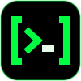
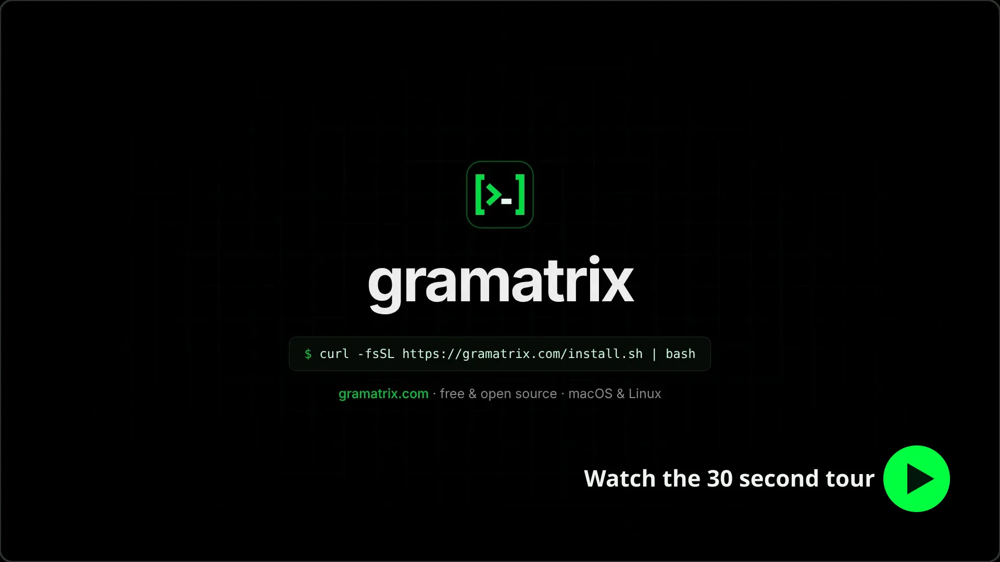

<p align="center">
  
</p>

<h1 align="center">Gramatrix</h1>

<p align="center">A desktop coding agent that runs on your own keys.</p>

<p align="center">
  <a href="https://gramatrix.com">Website</a> &middot;
  <a href="https://gramatrix.com/docs/">Docs</a> &middot;
  <a href="https://github.com/berkkaradalan/gramatrix/actions/workflows/ci.yml"></a>
</p>

<p align="center">
  <a href="https://www.gramatrix.com/#features">
    
  </a>
</p>

Open a project and work with an agent that reads code, edits files and runs commands, with you in
control of what it may do. Gramatrix runs on macOS and Linux.

## Features

- **Your own keys:** Anthropic, OpenAI, Gemini, Grok, DeepSeek, Mistral, Qwen, OpenRouter, Z.ai
  and MiniMax, plus the Z.ai, MiniMax, Kimi and Alibaba coding plans. Model lists come live from
  each provider.
- **Start anywhere:** ask a quick question with no setup, or pick a project folder so the agent can
  work on your code.
- **Permission modes:** from read-only to full access, with inline approvals.
- **Subagents:** the model can delegate focused work to agents it creates.
- **Bots:** agents with their own name, personality and a memory that lasts between chats.
- **Scheduled jobs:** run prompts on a cron schedule while the app is running.
- **Chat channels:** talk to your agent from Telegram or Slack after pairing your account.
- **No repeated password prompts:** keys are encrypted with your operating system keychain.
- **Usage tracking:** tokens and cost per chat, project, model and provider.
- **Customizable:** 22 themes, separate code themes, fonts, window transparency and a video
  background.

## Install

On macOS, Debian or Ubuntu, paste this into a terminal once.

```sh
curl -fsSL https://gramatrix.com/install.sh | bash
```

Gramatrix installs next to your other apps and opens like any of them. Run the command again to
update. On Linux you can also download the `.deb` from
[gramatrix.com](https://gramatrix.com/#download) instead.

To work on Gramatrix itself, see [CONTRIBUTING.md](CONTRIBUTING.md).

## Security

The agent can run commands on your computer. File tools stay inside the project folder, but
commands are not sandboxed, so an approved command can reach anything your user account can. Keep
the permission mode at **Ask first** unless you trust the task. See
[docs/agent.md](docs/agent.md).

## Documentation

- [User guide](docs/user-guide.md)
- [Architecture](docs/architecture.md)
- [Agent and permissions](docs/agent.md)
- [Bots](docs/bots.md)
- [Providers](docs/providers.md)
- [Scheduled jobs](docs/scheduled-jobs.md)
- [Chat channels](docs/channels.md)
- [Usage tracking](docs/usage.md)
- [Interface](docs/interface.md)
- [Contributing](CONTRIBUTING.md)

## License

[MIT](LICENSE). The bundled background video was generated with Google generative AI. Provider
logos are trademarks of their owners and only identify each provider.
